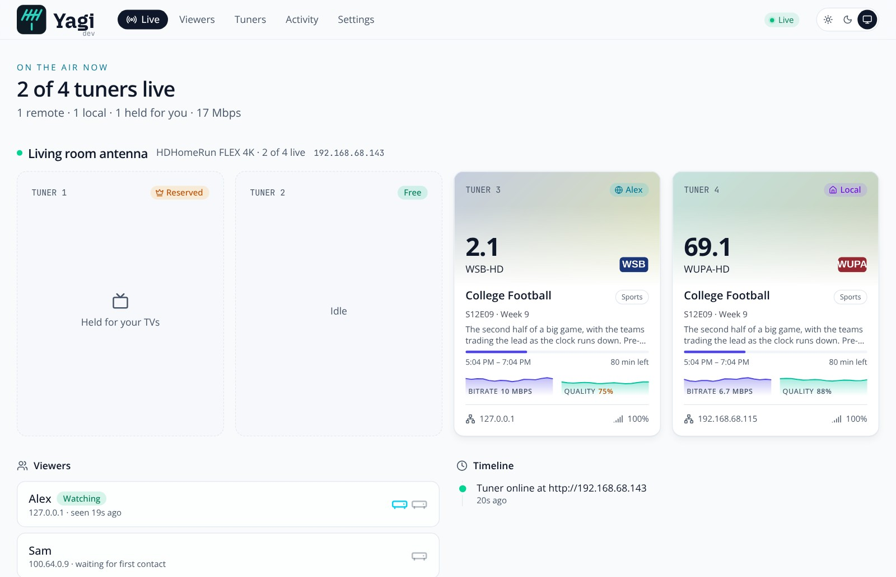

<h1 align="center">
  <picture>
    <source media="(prefers-color-scheme: dark)" srcset="docs/brand/yagi-wordmark-dark.png">
    
  </picture>
</h1>

<p align="center">
  Point your antenna <strong>anywhere</strong>.
</p>

<p align="center">
  Share an HDHomeRun tuner with Plex, Jellyfin or Emby servers on other networks, and keep track of who is using it.
</p>

<p align="center">
  <a href="https://github.com/johnschult/yagi/actions/workflows/ci.yml"></a>
  <a href="https://github.com/johnschult/yagi/releases/latest"></a>
  <a href="https://github.com/johnschult/yagi/pkgs/container/yagi"></a>
  <a href="go.mod"></a>
  <a href="LICENSE"></a>
  <a href="https://scorecard.dev/viewer/?uri=github.com/johnschult/yagi"></a>
</p>

---

<p align="center">
  <picture>
    <source media="(prefers-color-scheme: dark)" srcset="docs/screenshots/live-dark.jpg">
    
  </picture>
</p>

<p align="center"><sub>More pictures are in <a href="docs/web-ui.md">a tour of the web page</a>.</sub></p>

An HDHomeRun's `lineup.json` hands out the tuner's own LAN address, so a media server on another network can't use it
without firewall tricks on both ends. Yagi sits in front of the tuner and rewrites that address, so remote
media servers only ever talk to Yagi. It also decides who may use the tuner, and how much of it.

- **Rewriting proxy.** `discover.json`, `lineup.json`, `status.json` and the streams all go through Yagi. A viewer adds the
  tuner by `host:port` like any other HDHomeRun and needs no routing or NAT rules of their own.
- **Follows the tuner.** Finds the tuner by DeviceID (UDP broadcast, with a subnet scan as a fallback), so a DHCP address change doesn't break anything. It also lists the tuners it can see when you add one, with a name filled in, but never adds one by itself.
- **Limits.** An allowlist of viewer addresses, tuners per viewer, a cap on all viewers together, and tuners always kept free for you.
  Over the limit, a viewer gets the same HTTP 503 a busy tuner gives, so their software already knows what to do.
- **Several tuners.** Each looks like its own HDHomeRun on its own port.
- **A modern web UI for the tuner itself.** The HDHomeRun's own web page is small and dated: a lineup, a scan button, some details. Yagi's does what you would normally open that page for, and more, in a page for each tuner: **enable, favorite or disable channels** (singly or many at once), **scan for channels**, see **what the tuner says about itself** (model, firmware, DRM version, addresses, channel maps), **restart it** and **install firmware**, each after asking, with the tuner's own page still one link away for anything else. Then the things it never had: a **channel list you can filter** by quality, category and language, with a card for each channel from SiliconDust's program guide, a **signal test** that never interrupts anyone, and the average reception of what has been watched.
- **Live, and what happened.** Live tiles for each tuner (channel, logo, what's on with its picture and progress, who's watching, bitrate, signal), an Activity page of who watched what for the last 30 days, a page for each viewer, a **Logs** page, a copy-paste setup guide, light and dark themes, and a phone layout.
- **Firmware news.** Tells you when SiliconDust releases firmware for your model, and installs it when you press Install on the tuner's Firmware tab: the latest release for that tuner only, never an older one, and never on its own.
- **Notifications.** Optional messages to ntfy, Pushover or a webhook when there is new firmware, a tuner is offline for a couple of minutes (and when it's back), or a viewer is turned away. Each kind can be switched off, and each channel has a Test button.
- **Invite a Plex viewer with a link.** For viewers on Plex, you don't collect their addresses: send a link, they sign in with Plex and pick their server, and Yagi allows its internet address with the limit you set. They open the same link again if their address changes. See [Invite links](docs/security.md#invite-links).
- **Any private network.** Plain LAN, Tailscale, WireGuard, ZeroTier… Yagi just listens on a port, and serves private networks only: not the public internet. Getting the two servers onto the same network is up to you.
- **Its own Tailscale** (the `-tailscale` image). Yagi can join your tailnet as its own device, with no Tailscale on the machine: share that one device and nothing is opened on your router. Viewers and admins can be matched by Tailscale login, the LAN can be closed (*only on the tailnet*), and the admin page can be served over HTTPS. See [Built-in Tailscale](docs/tailscale.md).

> [!WARNING]
> **Status: early.** It runs a real FLEX 4K and is tested with the Go race detector and a UI test suite, but it is young software.
> Expect rough edges, and please read [Security](#security) (and [docs/security.md](docs/security.md)) before exposing it to anything beyond a network you trust.

## Quick start

With Docker (recommended), on the machine that can reach your tuner:

```sh
docker pull ghcr.io/johnschult/yagi:latest
```

Copy [docker-compose.example.yml](docker-compose.example.yml) next to your `yagi.json` and run `docker compose up -d`. It uses host networking, which Yagi needs to recognize its own streams and to offer your Tailscale and LAN addresses. Images are published for `amd64` and `arm64`.

Or build it (you need Go, see `go.mod`, and Node 22.12 or newer; the web UI is built first because the Go binary embeds it):

```sh
git clone https://github.com/johnschult/yagi
cd yagi
(cd web && npm ci && npm run build)    # builds into internal/ui/dist
go build -o yagi ./cmd/yagi
./yagi                            # starts the web page on :9244; add your HDHomeRun there
```

Then open the **setup link** it writes to its log (or `http://localhost:9244/` on the machine itself) to become the admin, add your tuner from the list the web page shows, and add a viewer. The web page is always on its own port, `9244`; each tuner you add gets a port of its own (`5004`, `5005`, …), and a viewer adds the tuner to their media server as `<this machine>:5004`. [Getting started](docs/getting-started.md) walks through every step, with the settings file, Docker and updating.

Releases are numbered by calendar, `YYYY.MM.PATCH`, and the image is tagged with that number as well as `latest`; the app shows its version in the footer, linked to the release notes.

## Documentation

| Page | Read it when |
|---|---|
| [Getting started](docs/getting-started.md) | You are installing Yagi, or opening it for the first time |
| [A tour of the web page](docs/web-ui.md) | You want to see what each page shows, with pictures |
| [Networking](docs/networking.md) | You are deciding how a viewer's server will reach yours: Tailscale, a VPN, the same network, or the same network |
| [Built-in Tailscale](docs/tailscale.md) | You want Yagi to join your tailnet by itself, with no Tailscale on the machine |
| [Media servers](docs/media-servers.md) | You are adding the tuner in Plex, Jellyfin or Emby |
| [Configuration](docs/configuration.md) | You want every setting, flag and file explained, and how the limits work |
| [Security](docs/security.md) | You want to know who can do what, and what Yagi sends over the internet |
| [Troubleshooting](docs/troubleshooting.md) | Something doesn't work: a page that won't load, a tuner that is offline, a viewer that is refused |
| [Frequently asked questions](docs/faq.md) | You wonder why it is called Yagi, or what changed from Antennarr |
| [API](docs/api.md) | You want to script against Yagi, or look at what the web page talks to |
| [Design notes](docs/DESIGN.md) | You are curious how it was built, what is built and what is planned |
| [Releasing](docs/RELEASING.md) and [Contributing](CONTRIBUTING.md) | You are making a release, or sending a change |

The app's **Help** link, at the bottom of its web page, opens the docs for the version you are running.

## Security

**HDHomeRun tuners have no authentication, and neither do their streams.** Yagi's protection is the address a request comes from, so please keep these in mind (the details are in [Security](docs/security.md)):

- **A new install is closed.** With no viewers nobody can use the tuner, and only this machine can open the admin page, until you use the one-time setup link in the log.
- **Viewers only get what a media server needs**; everything else the tuner serves (rescans, firmware upgrade, its own pages) answers `404`.
- **Private networks only.** Yagi serves your own network, a VPN and Tailscale, and drops connections from public internet addresses, so a port forwarded by mistake shows scanners nothing.
- **Admin by address** trusts the address a request arrives from, so behind a reverse proxy every request looks like the proxy's. Signing in with a Plex account is optional.
- **What it contacts:** only your tuners, plus, each switchable in Settings, SiliconDust's firmware changelog and program guide (and the firmware file when you press Install), plex.tv when someone signs in, and the notification service you set up. The web page itself loads nothing from outside. The full list, with what each one is sent, is in [Security](docs/security.md#what-leaves-your-network).

## Development

```sh
go test -race ./...               # the server
cd web && npm test                # the UI (Vitest)
```

Everything is in the standard library on the Go side (no third-party Go dependencies), and the tests use fake tuners and servers and never touch the real network. [CONTRIBUTING.md](CONTRIBUTING.md) has how to run it for development and retake the screenshots, and [docs/DESIGN.md](docs/DESIGN.md) the design notes.

## Roadmap

Planned: editing a tuner's address from the UI. Contributions and bug reports are welcome: see [CONTRIBUTING.md](CONTRIBUTING.md).

## License

[MIT](LICENSE). Yagi is not affiliated with or endorsed by SiliconDust, Plex, Jellyfin or Emby. HDHomeRun is a trademark of SiliconDust; Plex is a trademark of Plex, Inc.
See [web/README.md](web/README.md) for the third-party logos and fonts the web UI bundles.
