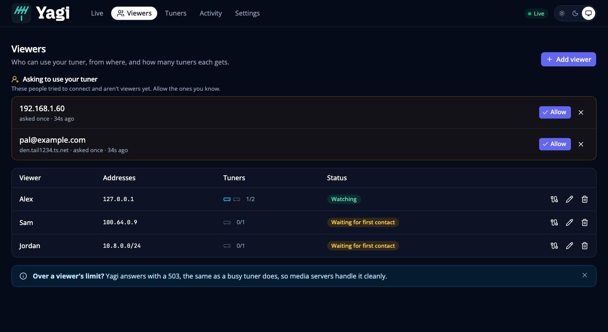
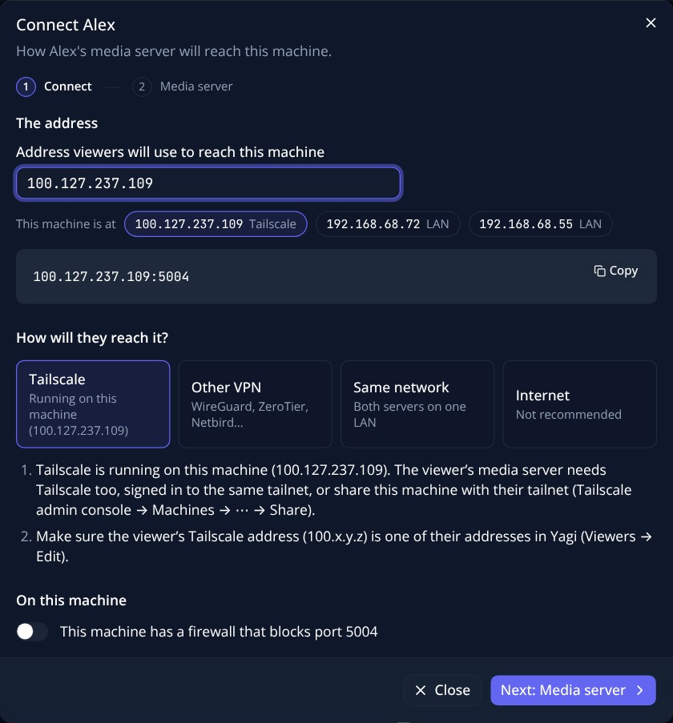

# Getting started

This takes you from nothing to a viewer watching your tuner. It assumes you have an HDHomeRun tuner on your network
and a machine that is always on to run Yagi (a small server, a NAS, a Raspberry Pi: anything that runs Linux, macOS or Docker).

## 1. Install

### Docker (recommended)

Images are published for `amd64` and `arm64`, tagged by release (`2026.10.0`) and `latest`.

Make a folder for Yagi and put the compose file in it:

```yaml
services:
  yagi:
    image: ghcr.io/johnschult/yagi:latest   # or pin a release, e.g. :2026.10.0
    container_name: yagi
    network_mode: host
    restart: unless-stopped
    user: "1000:1000"          # a user that owns ./config
    command: ["-config", "/config/yagi.json"]
    volumes:
      - ./config:/config
```

Then `mkdir config && chown 1000:1000 config` (use the same numbers as `user:`), write a first settings file
(step 2), and run `docker compose up -d`.

Use **host networking** (`network_mode: host`). Yagi tells its own streams from the ones your own TVs open by comparing addresses,
looks for the tuner with a broadcast on your network, and offers this machine's Tailscale and LAN addresses when you add a viewer. All three need to see the machine's real network, which a container on its own bridge network can't.
(With host networking you can't also remap the port: set `listen` in the settings file instead.)

### A program, without Docker

You need Go (see `go.mod` for the version) and Node 22.12 or newer. The web UI is built first, because the Go program embeds it.

```sh
git clone https://github.com/johnschult/yagi
cd yagi
(cd web && npm ci && npm run build)
go build -o yagi ./cmd/yagi
```

Run it with `./yagi -config yagi.json`. To start it on boot, use whatever your system uses (a systemd unit, launchd, an
Unraid User Script). `./yagi -version` prints the version.

## 2. Your tuner

**Usually there is nothing to do.** If you don't name a tuner, Yagi looks for HDHomeRuns on the network when it starts, for about ten seconds. What it finds is saved under `devices` in the settings file, so the next start uses the same tuner. One tuner is called `tuner`; several are called `tuner-<DeviceID>`, each on the next port up from `5004`.
This needs to see your network's broadcasts, so in Docker use host networking.

**If none answers, Yagi starts anyway**, with no tuner and only the web page, on port `5004`. Open it (step 3) and press **Find tuners**, or add the tuner by its address. The first tuner you add takes over port `5004`, so the page stays where it is. You can add more tuners, or remove one, later on the *Tuners* page.

To name a tuner yourself in the settings file or on the command line, list what is on your network:

```sh
yagi discover          # in Docker: docker exec yagi yagi discover
```

It prints one line for each HDHomeRun it finds: its DeviceID, its address and how many tuners it has, for example `10C03B06  http://192.168.1.50  4 tuners`. Then say which one to use, either with `-tuner 192.168.1.50` or in the settings file. The smallest useful file is:

```json
{
  "devices": [
    { "name": "antenna", "listen": ":5004", "tuner": "192.168.1.50", "id": "10C03B06" }
  ]
}
```

- `name` is a short key (letters, digits, `.`, `_`, `-`). It appears in URLs and settings, so pick one you won't change. You can give the tuner a friendlier display name later, in the web page.
- `listen` is the port viewers' servers connect to. `:5004` means every address on this machine.
- `tuner` is where the tuner is now. `id` is its DeviceID: with it, Yagi finds the tuner again if its address changes (DHCP). You can leave `id` out and Yagi learns it the first time it reaches the tuner, but then it can't search for a tuner it has never seen, so adding it now is better.

If the file doesn't exist, Yagi creates it with the defaults when it starts, and saves the changes you make in the web page to it.
You can also run one tuner straight from the command line (`yagi -tuner 192.168.1.50`); the settings file is then `yagi.json` in the directory you ran it from.
The full list of settings is in [Configuration](configuration.md).

## 3. Open the web page

A new install is closed: **nobody can use the tuner yet, and only the machine Yagi runs on can open the web page.**
To open it from your own computer, use the **setup link** Yagi writes to its log when it starts for the first time:

```
FIRST RUN: nobody is an admin yet. To set up, open one of these links from the device you want to use as the admin. ...
  setup link url=http://100.64.0.5:5004/yagi/claim?token=...
  setup link url=http://192.168.1.5:5004/yagi/claim?token=...
```

(`docker logs yagi`, or wherever you run it.) Open the link that matches how you reach the machine, from the computer you want to use as your admin, and press **Make this device an admin**. Yagi saves that computer's address under `admin` in the settings file and sends you to the web page, `http://<this machine>:5004/yagi/`.

- The link works **once**, only from a private network (your LAN, Tailscale, a VPN), and only until Yagi restarts. If you restart before using it, a new link is written to the log. Anyone who can read the log can use it, so treat the log like a password until you have.
- Five wrong tries from one address lock that address out for ten minutes.
- If you open the web page on the machine itself (`http://localhost:5004/yagi/`) you don't need the link: that machine is always an admin.
- If your computer's address changes (a new DHCP lease, say), add the new one under *Settings → Access*, or turn on Sign in with Plex (see [Security](security.md)).
- If the settings file can't be saved there is nothing to claim into, and no link is offered: fix where the file lives (`-config`) first.

## 4. Add a viewer

A *viewer* is a person or a server you share the tuner with. Open **Viewers → Add viewer**. It is a short set of steps: who they are, how their server reaches yours, and what to do in their media server (steps 4, 5 and 6 here). Start by filling in:



- **Name:** whoever it is.
- **Addresses:** the address their media server will connect *from*, as your Yagi sees it. Single addresses (`100.64.0.7`) or ranges (`10.8.0.0/24`). On Tailscale it is the viewer machine's Tailscale address. [Networking](networking.md) explains how to find it.
- **Tuners:** how many tuners they may use at once.

Only listed viewers can use the tuner, and only loopback (this machine), the addresses under `admin` in the settings, and signed-in Plex accounts can open the admin pages.
If you lose access to the web page, you can always get back in by one of these:

- **Open it from the machine Yagi runs on** (`http://localhost:5004/yagi/`), or through an SSH tunnel: `ssh -L 5004:127.0.0.1:5004 yourserver`, then browse to `http://localhost:5004/yagi/`.
- **Add your own computer's address to `admin`** in the settings file, then send Yagi `SIGHUP` (or restart it).
- **Turn on Sign in with Plex** (*Settings → Access*) while you still have access, then add your Plex account. After that you can open the page from any address that can reach the port. See [Security](security.md).

## 5. Point a media server at it




Yagi looks like an ordinary HDHomeRun at `<address>:<port>`. The Add viewer steps write this out for you, with your real addresses filled in; for a viewer you have already added, use **Connection steps** on their row on the Viewers page.
For the full walk-through, see [Media servers](media-servers.md).

## 6. Check it works

On the viewer's server: `curl http://<address>:5004/discover.json` should print JSON that mentions your tuner's name and an address that is
**Yagi's, not the tuner's own**. Then watch a channel. In the web page's **Live** view you will see the tuner's tile with the channel, who is watching, the bitrate and the signal.

If something doesn't work, [Troubleshooting](troubleshooting.md) covers the usual causes.

## Updating

- **Docker:** `docker compose pull && docker compose up -d`. If you use Watchtower or something like it, `latest` updates itself. To stay on one release, pin the tag.
- **From source:** pull, rebuild, restart.

Releases are numbered by calendar, `YYYY.MM.PATCH` (for example `2026.10.0`). The version is at the bottom of the web page, linked to its release notes.
Your settings file carries over between versions. Read the release notes before updating: if a release changes the settings, they say so.
