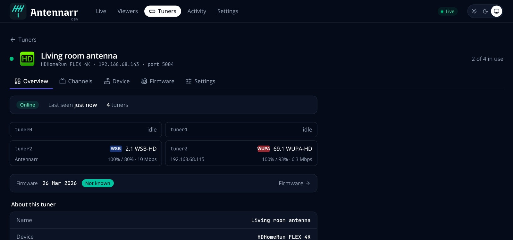
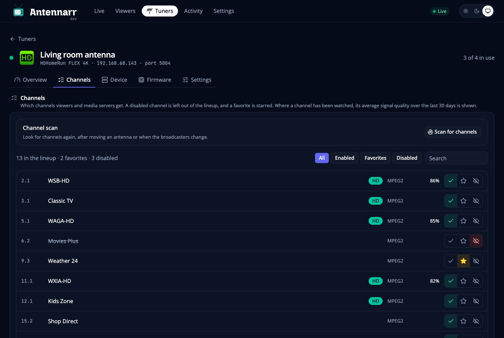
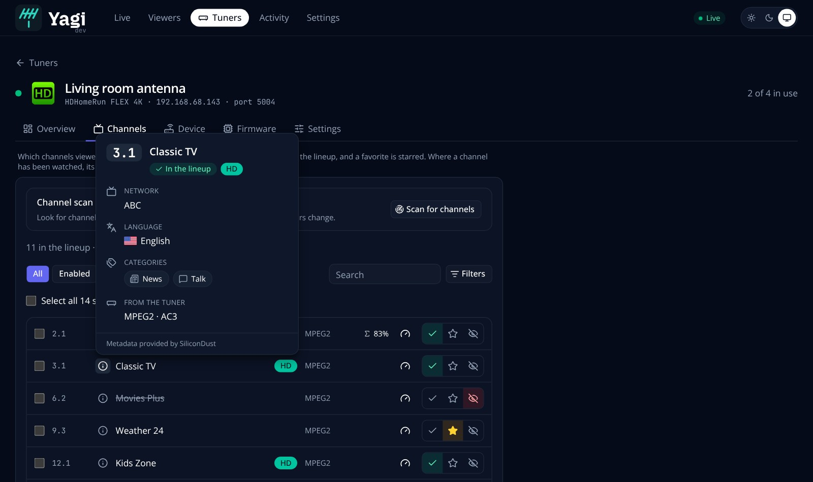
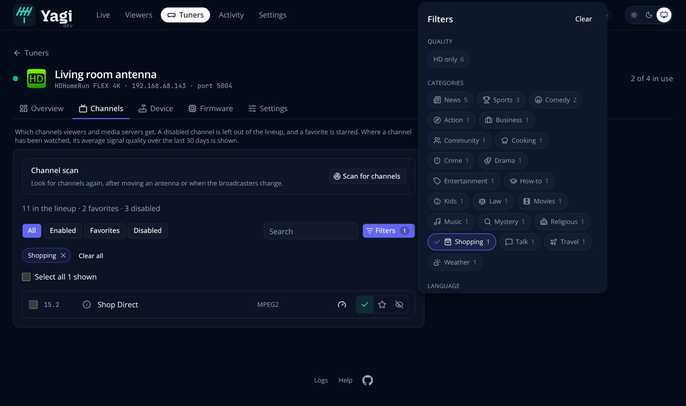
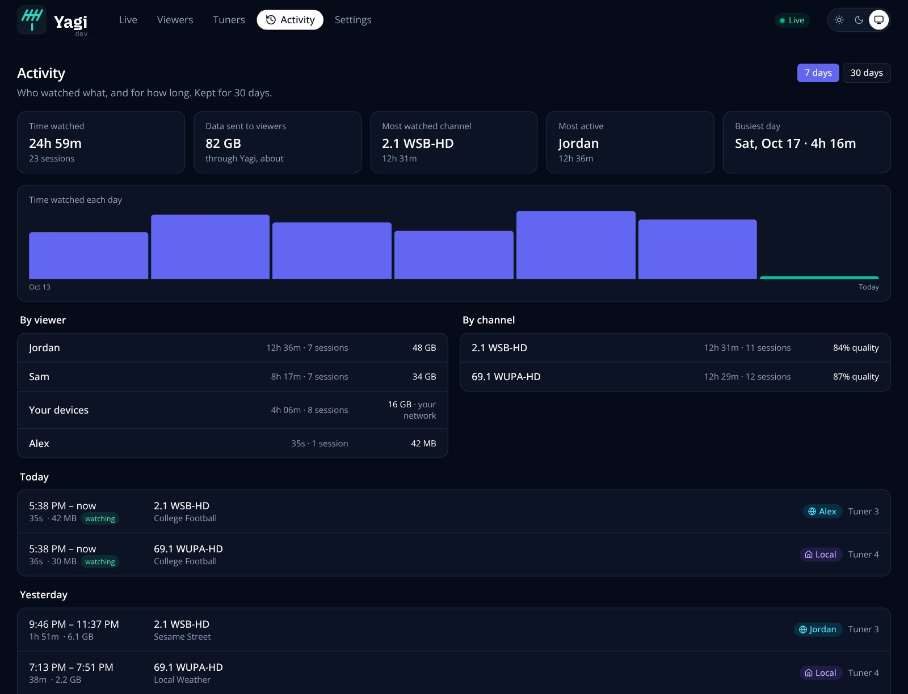
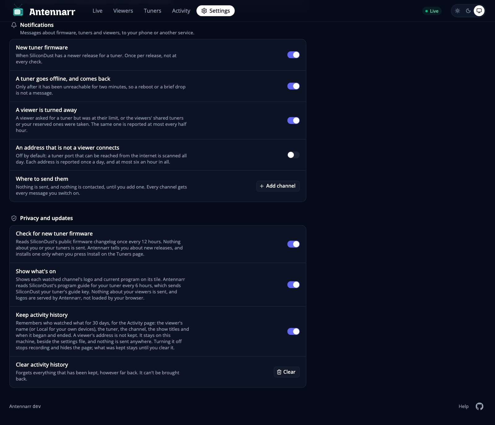
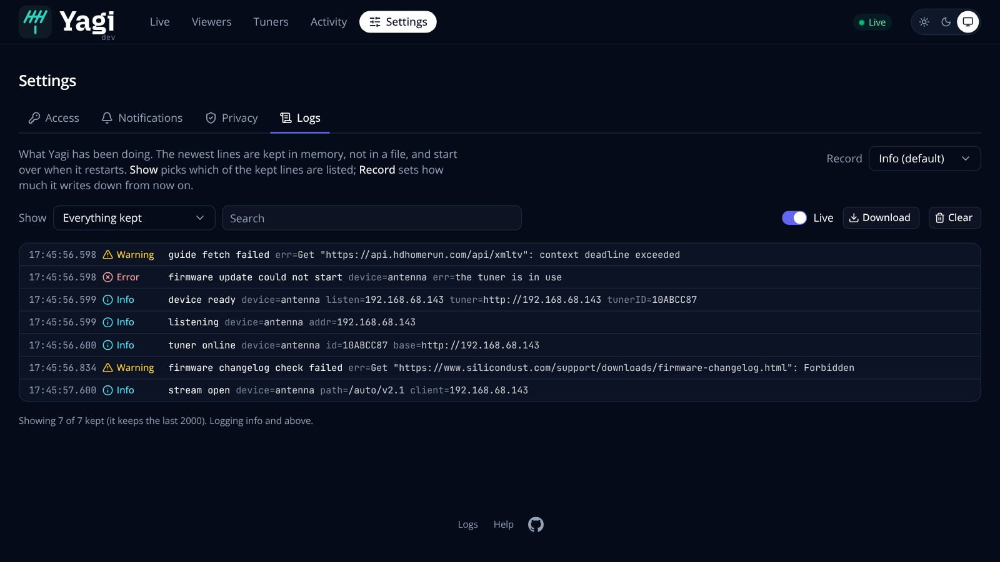
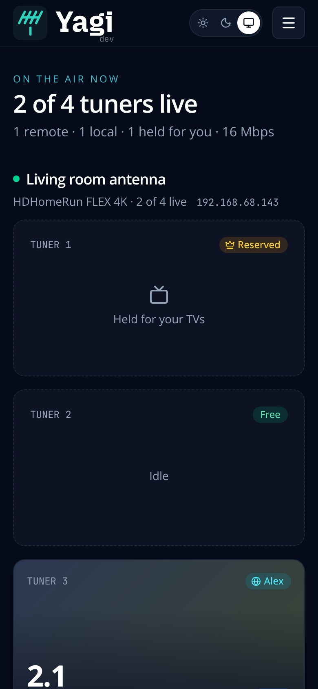
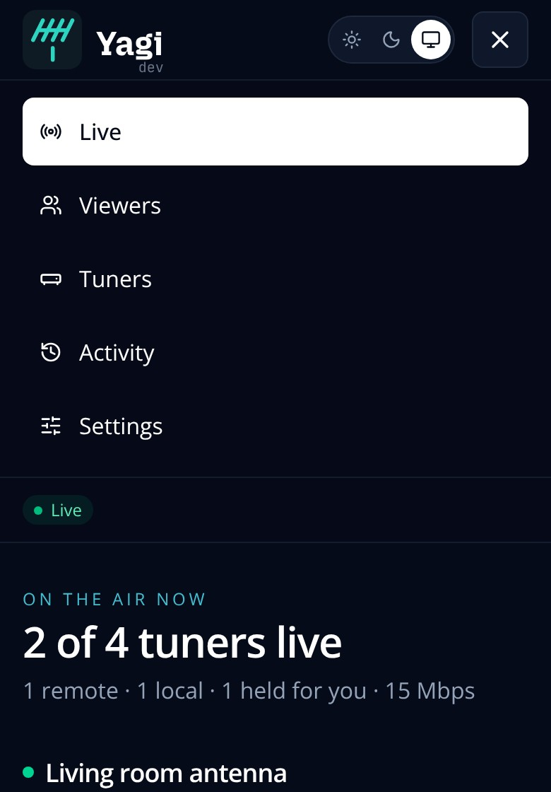

# A tour of the web page

Open it at `http://<yagi address>:5004/yagi/` (see [Getting started](getting-started.md#3-open-the-web-page)).
It has light and dark themes, and follows your computer's unless you choose one with the buttons at the top right.
Besides sharing the tuner, it is a web UI for the tuner itself: it does what you would normally open the HDHomeRun's own web page for (channels, scanning, device details, restarting, firmware), more clearly and with more on top (what is on, who is watching, signal tests, filtering, history, logs). The tuner's own page is still one link away on a tuner's *Device* tab for anything it doesn't cover.
These pictures are of a demo with a made-up tuner, guide and viewers.

## Live

  <picture>
    <source media="(prefers-color-scheme: dark)" srcset="screenshots/live-dark.jpg">
    
  </picture>

What is happening right now. Each tuner has a header (its name, its model, how many of its tuners are live and its address), and one tile for each of its tuners:

- **Who has it.** A pill at the top: a viewer by name (globe), one of your own devices (house, shown as *Local*), a tuner held for your TVs (crown), or free.
- **What is on.** The channel, its logo, and, from SiliconDust's program guide, the show's picture faded behind the top of the tile, its title, category, episode and description, and how far into it you are. A tile without a picture is normal when the guide has none.
- **How it is doing.** The bitrate and the signal quality over the last couple of minutes, and the signal strength as bars (more bars, stronger) with where the stream is going. They are only colored when reception is fair (amber) or poor (red).

Below the tiles are your viewers, who is watching, and a timeline of events (a stream starting, a viewer turned away, a tuner offline). A tuner that is being restarted or updated is shown that way, not as offline. Turn the guide off in *Settings → Privacy* and the tiles show only the channel.

## Viewers

Who may use the tuner, from which addresses, and how many tuners each gets at once. **Add viewer** walks through three steps (who, how their server reaches yours, and what to do in their media server); **Connection steps** on a row reopens it. See [Getting started](getting-started.md#4-add-a-viewer).

## Tuners

The **Tuners** page is a list, one row for each tuner with its status, where it is, how many of its tuners are in use and a flag when it has a firmware update. With only one tuner it opens that tuner's page directly (its *Tuners* link back goes to the list, where you add another).

A tuner's page has five sections as tabs, each with its own address (`/tuner/<name>/device` and so on):

- **Overview:** how it is right now (online, when it was last seen, how many tuners it has), what is on each of its tuners, a line about its firmware, and what Yagi knows about it (its name, device, model, DeviceID, address and port). Anything with more behind it is a link to the tab that has it: the device's details go to *Device*, the name and port to *Settings*, and the firmware line to *Firmware*.
- **Channels:** every channel the tuner has found, with a button for each to **enable** it, make it a **favorite** or **disable** it (a disabled channel is left out of the lineup viewers and media servers get, so it disappears from their guide when they next refresh). The **i** beside a channel's name opens a card about it: its number and name, whether it is in the lineup, and, from SiliconDust's program guide, the network it carries, its language (with a flag) and its categories (with a picture for each). Anything the guide doesn't say is left out. Filter by state, search by number or name, and press **Filters** to narrow the list by quality (HD only), by category (news, shopping, kids, religious and so on, each with a picture and how many channels it is on) and by language; the ones you have chosen show as chips above the list that you can take off one at a time, and on a phone the buttons stack so nothing scrolls sideways. A channel the program guide says nothing about is left out of a category or language filter, and the panel says how many that is. Tick channels (or **select all** of those shown) to enable, favorite or disable them together; the changes are sent to the tuner one at a time, with progress, and stop at the first the tuner refuses. Where a channel has been watched, its average signal quality over the last 30 days is shown, colored when it is fair or poor. The gauge button on a channel **tests its signal**: Yagi tunes a free tuner to it for about ten seconds and shows its strength and quality (or "No signal"), colored when it is fair or poor. It only uses a tuner nothing is using, never interrupts anything, and is greyed out, with the reason, when every tuner is in use or the tuner is scanning. **Scan for channels** starts the tuner's own channel scan (Antenna or Cable), after asking, since a scan takes all of the tuner's tuners until it is done; progress is shown, with a Stop button.
- **Device:** what the tuner says about itself: hardware model, firmware, ATSC 3.0 DRM version, device ID, MAC address, IP address, subnet mask, channel maps and modulations. It is read when you open it and on **Refresh**, and it is read-only. **Restart** turns the tuner off and on again, after asking, and says if anything is in use. There is a link to the tuner's own page for what Yagi does not show.
- **Firmware:** the version, when SiliconDust's changelog was last read, and what changed. When a newer release applies to your tuner there is an **Install** button; see [Configuration](configuration.md) for what it does and [Security](security.md) for what it contacts.
- **Settings:** the name shown on this page (media servers are always told the device's own name), the port media servers use, and removing the tuner from Yagi (the tuner itself is untouched).

  
  

## Activity

Who watched what, and for how long, for the last 7 or 30 days: the total time, how much data went out to viewers (about, through Yagi, which is what your upload paid for), the most watched channel, who watched most, the busiest day, a bar for each day, a list by viewer (time and data) and by channel (time and the average signal quality, colored when it is fair or poor), and the sessions by day with the shows that were on. A viewer's name opens their own page: their data and time for each day, what they watched and their sessions. It is kept for 30 days in a file next to the settings file and goes nowhere else. Switch it off, or clear it, in *Settings → Privacy*; the *Activity* item then leaves the top bar. See [Configuration](configuration.md#files-yagi-keeps).

## Settings

Four tabs, each with its own address: **Access** (how much of each tuner viewers may use, who may open this page, and Sign in with Plex), **Notifications** (ntfy, Pushover or a webhook, and which events send a message), **Privacy** (the switches for what Yagi reads and keeps: the firmware check, the program guide and the activity history, and clearing that history) and **Logs** (below). Every setting is explained in [Configuration](configuration.md). On a phone the tabs share the width, each with its icon above its name.

### Logs

Yagi's own log. Open it from the *Logs* tab of *Settings*, the **Logs** link in the footer, or, when a tuner is offline, from *See why in the logs* on its Overview (which opens the log already searched for that tuner): what it has been doing, with the newest line at the bottom. Each line has its time, a level (Debug, Info, Warning or Error, each with its own icon and color), the message and its details. Show everything, info and above, warnings and errors, or errors only; search the messages and their details (the search box has a clear button); **Live** keeps it up to date every few seconds and following the newest line until you scroll up to read; **Download** saves what is shown as a text file; **Clear** forgets what is kept. The **Log** menu at the top right is how much is logged: *Info* is the default, *Debug* adds the detail that is useful when something is wrong, and it is a setting, so it changes at once and is kept. The lines are kept in memory (the last 2,000), not in a file, so they start over when Yagi restarts; they are also still written to standard error as before (`docker logs yagi`). Anything that looks like a secret (a token, a key, the guide key) is hidden before a line is kept.

## On a phone

  
  &nbsp;
  

The same pages, with a menu and cards instead of wide tables.
